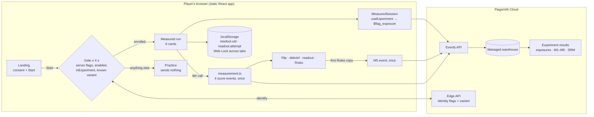

# Readout — Would you ship it?

Built for **Track 01 · Test Something Real** of the WeMakeDevs × Flagsmith hackathon.

|                  |                                                                                                            |
| ---------------- | ---------------------------------------------------------------------------------------------------------- |
| Live app         | _Placeholder: added when deployed._                                                                        |
| Demo video       | _Placeholder: added before submission ([script](docs/DEMO.md))._                                           |
| Pre-registration | [EXPERIMENT.md](EXPERIMENT.md), frozen at tag `measured-v1` = `3c0909d9bee5bc4408dbe48c351a34f7bb9f6903` (17 Nov 2026) |
| Results          | _Placeholder: the Production experiment starts on or after 26 Nov 2026 08:00 IST._ See [§17](#17-results). |
| Evidence         | [evidence/](evidence/): Development and Production kept apart                                              |

## 1. In one sentence

Readout is a four-minute challenge that shows developers six realistic A/B test results, asks "would you ship it?",
and turns their mistakes into a six-step review checklist, while a live Flagsmith experiment tests which way of
presenting a result leads to better calls.

## 2. The problem

Experiment results get misread every day. A significant **loss** is shipped because "p < 0.05". A promising but
inconclusive result is shipped because "86% sounds good". A broken traffic split is interpreted instead of investigated.
A big lift on a tiny sample is trusted. The numbers on the dashboard are right; the decision is wrong. And nobody knows
whether the way a tool _presents_ the inference (a p-value, or a "chance to beat control") makes those mistakes more or
less likely.

## 3. Who it's for

Developers, product managers and anyone who reviews A/B test results: individually in four minutes, or as a team in a
30-minute drill with no accounts.

## 4. What it does

| Part                 | What the player gets                                                                                                                                                                                                       |
| -------------------- | -------------------------------------------------------------------------------------------------------------------------------------------------------------------------------------------------------------------------- |
| **Challenge**        | Six fictional results, each with a hypothesis, the raw counts, lift, 95% interval, an inference line and guardrails. Four calls: ship, keep the control, keep collecting, don't trust the data. No feedback until the end. |
| **Flip**             | The one line that differs between the two versions is revealed: "here's what the other half saw".                                                                                                                          |
| **Debrief**          | Per result: your call, the defensible call, the trap, why, why not the others, and the Rule that catches it next time.                                                                                                     |
| **Personal readout** | Score, the mistake patterns your calls show (each linked to the Rule to apply), a table of all six.                                                                                                                        |
| **Readout Rules**    | Six checks in order, a decision ladder and a review template, copied as GitHub Markdown into a PR or review doc.                                                                                                           |
| **Team drill**       | An invite link, a 30-minute script and a presenter view (←/→, F flips the line, R reveals the call and the Rule).                                                                                                          |
| **Practice**         | The same challenge with the inference line switchable, never measured, never contacts Flagsmith.                                                                                                                           |

## 5. The experiment question

> Do developers make more defensible calls when a result's inference reads **"Chance to beat control · 86%"**
> instead of **"p-value · 0.27"**?

Hypothesis (stored in Flagsmith, written before any data): showing chance to beat control instead of a p-value
increases the Readout score per exposed player without reducing completion. The honest prior is an inconclusive pilot
at 120–300 players ([EXPERIMENT.md §8](EXPERIMENT.md#8-sample-size)); the outcome is genuinely uncertain because the
chance framing should help on hidden-direction losses and may hurt on "86%" inconclusives.

## 6. The two flag variants

The multivariate flag `readout_framing` (50 / 50, rollout 100%) changes exactly **one line** on each result card.
Everything else, every pixel and its position, is identical (checked in a real browser by `npm run check:arms`).

| Variant   | `flag.variant`  | Value           | The inference line on a result  |
| --------- | --------------- | --------------- | ------------------------------- |
| Control   | `control`       | `p_value`       | `p-value · 0.0015`              |
| Treatment | `chance_to_win` | `chance_to_win` | `Chance to beat control · < 1%` |

Both lines are computed from the same counts by the same model, a port of Flagsmith's own statistics. For a
"lower is better" guardrail, the chance is the chance the change is an improvement, as in Flagsmith.

## 7. Architecture



No backend, no database of our own, no accounts. Two modules are the only code allowed to talk to Flagsmith
(`npm run check:isolation`): `src/flagsmith/MeasuredSession.tsx` (exposure) and `src/flagsmith/measurement.ts` (events).

## 8. Flagsmith integration

- **Assignment.** The arm comes from Flagsmith's deterministic bucketing for the player's random browser ID. The app
  branches on `flag.variant`, never on the display value.
- **A strict gate.** A run is measured only if the flags came from the server, the flag is enabled, the identity is
  `inExperiment`, and the variant is known, all within 4 s. Anything else becomes a clearly labelled practice run.
- **Exposure where the variant is seen.** `useExperiment('readout_framing')` runs in one component that mounts with
  the first result card, never on the landing page; Flagsmith keeps the first exposure per identity.
- **Events.** `trackEvent` sends M1–M4 in one batch when the run ends, with the identity passed explicitly; M5 on the
  first Rules copy. The app awaits `flushEvents()` (capped at 3 s) before the flip.
- **Delivery you can trust.** The app watches the real HTTP outcome of each events POST and re-sends a batch once, on a
  later visit, only if it was _observed_ to fail. An unknown outcome is never re-sent.
- **Two tabs, one player.** Every write to the attempt runs under a Web Lock (`readout.attempt`): Start, each answer,
  scoring, the send claim and delivery records. Two tabs get one identity, one answer per card, one score batch, one
  M5 (unit tests and a real two-page Chrome test, TT-1…TT-4).
- **Ship the winner with the same flag.** After the experiment, the environment's flag value sets the default framing
  for everyone (EXPERIMENT.md §14): a flag change, not a code change.
- **Setup is reproducible.** [`flagsmith/`](flagsmith/) holds the metric and experiment bodies and the
  [setup and validation runbook](flagsmith/SETUP.md); a test keeps them in step with the code. Pinned SDK:
  `@flagsmith/flagsmith` 12.4.0.

## 9. Metrics

| #   | Metric                                                | Event                          | Aggregation | Expected direction | Role        |
| --- | ----------------------------------------------------- | ------------------------------ | ----------- | ------------------ | ----------- |
| M1  | Readout score (unfinished = 0)                        | `readout_score` (correct ÷ 6)  | Mean        | increase           | **Primary** |
| M2  | Finished measured run                                 | `readout_completed`            | Occurrence  | not_decrease       | Guardrail   |
| M3  | Correct call on the significant loss                  | `readout_loss_call` (1/0)      | Mean        | increase           | Secondary   |
| M4  | Correct call on the promising-but-inconclusive result | `readout_near_miss_call` (1/0) | Mean        | not_decrease       | Guardrail   |
| M5  | Copied the Readout Rules                              | `readout_rules_copied`         | Occurrence  | increase           | Exploratory |

All metrics have direction `up`. Full definitions: [EXPERIMENT.md §6](EXPERIMENT.md#6-metrics).

## 10. Measurement methodology

- **Unit:** one random browser ID, created only on Start. **Exposure:** the first result card of the measured run.
- **One measured run per ID.** Later plays are practice. The six results come in a fixed order in measured runs.
- **Mean semantics.** Flagsmith's Mean is the per-identity average, and 0 for an exposed identity with no event, so an
  unfinished run counts as 0 in M1 (intention to treat). Metric events are not de-duplicated by Flagsmith, which is
  why a batch is re-sent only when it is known to have failed.
- **Frozen before Production.** Everything that decides what a measured player sees or sends (33 files, including the
  lockfile, this pre-registration, the outcome wording and the SRM check) must match the `measured-v1` tag; `npm run check:release` gates the Production start.
- **Production is real players only.** No team plays, no scripts, no overrides. Synthetic traffic is Development-only
  and labelled.

## 11. Statistical interpretation

Read in Flagsmith only, by the rule written before any data ([EXPERIMENT.md §10](EXPERIMENT.md#10-decision-rule)):

| M1 chance to beat control | Guardrails M2, M4 | Decision                                                                                         |
| ------------------------- | ----------------- | ------------------------------------------------------------------------------------------------ |
| > 95%                     | not losing        | Roll out `chance_to_win` as the default; also report the stricter 97.5% (≈ two-sided p < 0.05)   |
| < 5%                      | —                 | Keep `p_value`                                                                                   |
| 5–95%                     | —                 | **Inconclusive**: report lift and interval, keep the control, state the sample a follow-up needs |

A guardrail that is losing (or whose whole interval is below zero) keeps `p_value`, whatever M1 shows. Not read at
all while the pre-registered sample-ratio check (`scripts/srm.mjs`, Flagsmith's formula on its exposure counts; Flagsmith
2.291.0 computes none for this flag set-up) warns, or either arm is still "collecting data". The exact wording for each outcome
was written in advance (`src/content/outcomes.ts`, shown on the About page). Flagsmith's 95%
threshold is roughly a two-sided p < 0.10; we say so wherever it is used. M3 and M5 are never the headline.

## 12. Privacy and limitations

Nothing is sent to Flagsmith before the player presses **Start the challenge**, and the consent text sits right above
that button, next to "Practise without being measured". On Start, Readout creates a random ID stored in this browser.
No name, email or account. Flagsmith, which runs the experiment, is the only service that receives anything: no
cookies of our own, no separate analytics service and no ad pixels. The ID is **pseudonymous, not anonymous**: it
links the exposure to the player's calls, and Flagsmith receives standard request information such as the IP address.
Clearing site data, or another browser or device, gives a new ID.

Sent, exactly (a test keeps this list and the code in step):

- events, and what each is for:
  - `$flag_exposure` (feature `readout_framing`): which version the player was shown, so the arms can be compared;
  - `readout_score`: correct calls ÷ 6, the primary metric M1;
  - `readout_completed`: finished all six, guardrail M2;
  - `readout_loss_call`: the call on the significant loss (S2), secondary M3;
  - `readout_near_miss_call`: the call on the promising-but-inconclusive result (S3), guardrail M4;
  - `readout_rules_copied`: copied the Rules after finishing, exploratory M5;
- metadata `scenarioSet`, `attemptId`, `answers`, `totalSeconds`, `ref`, `variantMismatch`, `send`, plus the SDK's own
  `experiment_id` and `sdk_version`.

Practice runs, the Rules page, the team guide and the presenter view send nothing.

**Limitations.**

- The ID belongs to this browser: clearing site data, a private window or another device can be measured again.
  Accounts would prevent this; Readout deliberately has none.
- Ad-blockers that block `events.api.flagsmith.com` stop measurement silently.
- Players are self-selected developers from our own channels; 120–300 players is a pilot, not a definitive answer.
- Guardrails are not safety proofs: at this size we can say "no harm detected", never "safe".
- All six results are fictional teaching cases, labelled `FICTIONAL TEST`. One (S5) reuses Flagsmith's own
  sample-ratio-mismatch example counts, deliberately.
- Built before the event, which the organisers permitted ([DEVLOG.md](DEVLOG.md)); the Production experiment and all
  evidence are event-only. AI coding tools were used during the build.

## 13. Install and run locally

Requirements: Node 20 or later (developed on Node 26) and npm.

```bash
npm ci
cp .env.example .env    # then set VITE_FLAGSMITH_ENV_KEY to your Development client-side key
npm run dev
```

Without a key the app still works, as practice only.

### For hackathon judges and reviewers (local quick-explore)

With `npm run dev` running:

- **Full practice run (no Flagsmith key required):** open `http://localhost:5173/practice` or press **Practise without being measured** on `/`.
- **Compare both Flagsmith variants directly:** open `http://localhost:5173/dev/app.html?route=/challenge&variant=control` (`p-value`) alongside `http://localhost:5173/dev/app.html?route=/challenge&variant=chance_to_win` (`Chance to beat control`).
- **Team presenter mode:** open `http://localhost:5173/team/present` (`←`/`→`, `F` flips the inference line, `R` reveals the defensible call and trap, `Esc` returns to `/team`).
- **Automated verification (dev + prod CSP + browser + arm layout parity):** `VITE_FLAGSMITH_ENV_NAME=development npm run check:all`.

## 14. Environment configuration

| Variable                  | Value                                                                                                                                                                                    |
| ------------------------- | ---------------------------------------------------------------------------------------------------------------------------------------------------------------------------------------- |
| `VITE_FLAGSMITH_ENV_KEY`  | The Flagsmith **client-side** environment key. Development key locally and on previews; Production key only on the production deploy. Public by Flagsmith's design, but never committed. |
| `VITE_FLAGSMITH_ENV_NAME` | `development` or `production`. Required: the build fails without it, and refuses a production deploy context with anything but `production`.                                             |
| `VITE_REPO_URL`           | Optional: the public repository, for the footer and About links.                                                                                                                         |

Admin API tokens, organisation keys and server-side keys are never used by the app and must never be added to it,
to `.env`, or to this repository. `.env` is git-ignored; `.env.example` holds placeholders only.

## 15. Tests and checks

| Command                                                   | What it proves                                                                                                                                                                                                                                                                                                      |
| --------------------------------------------------------- | ------------------------------------------------------------------------------------------------------------------------------------------------------------------------------------------------------------------------------------------------------------------------------------------------------------------- |
| `npm run check:all`                                       | Everything below except `links` and `impact`, in order                                                                                                                                                                                                                                                              |
| `npm test`                                                | Unit and integration tests (Vitest, jsdom): statistics against reference vectors and edge cases, answer keys, scoring, the attempt state machine and cross-tab locking, the readiness gate, exposure scope, the exact events on the wire, page-level arm invariance, setup files, the freeze checker, deploy config |
| `npm run typecheck`                                       | TypeScript, strict                                                                                                                                                                                                                                                                                                  |
| `npm run check:isolation`                                 | Only the two measurement modules can expose or send; no other network call; no external scripts                                                                                                                                                                                                                     |
| `npm run check:secrets`                                   | No credentials, no client key in source, no email addresses, correct `.gitignore`; never prints a value                                                                                                                                                                                                             |
| `npm run check:browser`                                   | The real app in Chrome (via `playwright-core`), Flagsmith faked locally: keyboard-only journey, two tabs at once (TT-1…TT-4), mobile by touch, 44 px targets, axe on 12 pages × 7 viewports, failure modes                                                                                                          |
| `npm run check:browser:prod`                              | The same against a production build served with the real deploy headers: zero CSP violations, zero console errors, working deep links                                                                                                                                                                               |
| `npm run check:arms`                                      | Real-browser layout of every element is identical between the two arms at 320 / 375 / 768 / 1280 px                                                                                                                                                                                                                 |
| `npm run check:frozen` / `check:release`                  | The measured files match the `measured-v1` tag (committed, staged, unstaged, renamed, deleted, untracked); `check:release` also fails if the tag is missing                                                                                                                                                         |
| `npm run build`                                           | Production bundle in `dist/`                                                                                                                                                                                                                                                                                        |
| `npm run dev:synthetic -- …`                              | Development-only labelled synthetic pipeline check (see [flagsmith/SETUP.md](flagsmith/SETUP.md)); refuses without explicit Development confirmations                                                                                                                                                               |
| `npm run links -- <url>`                                  | One tagged link per recruitment channel and the message templates; sends nothing                                                                                                                                                                                                                                    |
| `npm run impact -- --file … --env … --as-of … --source …` | The pooled impact report from a real event export; refuses unlabelled, synthetic or contaminated input                                                                                                                                                                                                              |

The browser checks use the Google Chrome installed on the machine (`CHROME_PATH` to override) and never contact
Flagsmith or any other host. They are simulated-network tests: they prove the app's behaviour, not Flagsmith's
ingestion, which is validated in Development ([flagsmith/SETUP.md §2](flagsmith/SETUP.md)).

## 16. Deploy

`vercel.json` and `netlify.toml` (kept identical by a test) set an SPA rewrite for deep links, a
Content-Security-Policy that allows only this site plus `edge.api.flagsmith.com` and `events.api.flagsmith.com`,
`Referrer-Policy: no-referrer`, `nosniff`, no framing, and immutable caching for hashed assets.

1. Set `VITE_FLAGSMITH_ENV_NAME=development` and the Development key on previews.
2. Set `VITE_FLAGSMITH_ENV_NAME=production` and the Production client key on the production scope only.
3. Build command `npm run build`, output `dist/`.
4. Before Production starts: G-1…G-6 in [flagsmith/SETUP.md §4](flagsmith/SETUP.md), including `npm run check:release`.

## 17. Results

**There are no results yet, and none are shown here until they exist.** The Production experiment starts on or after
26 Nov 2026 08:00 IST with real players only. Results will be added from the Flagsmith console, each with the
environment and the time it was read, using the pre-registered wording for whichever outcome applies
([template](evidence/production/RESULTS-TEMPLATE.md)). Every refresh is logged in
[evidence/results-log.md](evidence/results-log.md). Development data is never quoted as a finding. Recruitment
targets (never counts) are in [RECRUITMENT.md](RECRUITMENT.md); usability findings, if any are collected, in
[docs/USABILITY.md](docs/USABILITY.md).

## 18. Demo video

_Placeholder: link added when recorded._ Script, recording directions and a 2-minute backup: [docs/DEMO.md](docs/DEMO.md).

---

### Repository layout

```
src/
  app/          App shell, routes, scroll handling, error boundary, not-found
  routes/       Landing, Run (challenge + practice), Readout (flip, debrief, summary), Rules, Team, About
  components/   ResultCard, DecisionBar, site chrome; ui/classes.ts holds the Tailwind class recipes
  content/      Scenarios, analysis, scoring, Rules, outcomes, consent, privacy and recruitment copy
  stats/        Port of Flagsmith's stats.py, formatting, reference vectors
  flagsmith/    Client and gate, MeasuredSession (exposure), measurement (events), delivery monitor
  run/          Attempt store (persisted state machine, Web Lock), controller, StudyContext
  evidence/     The impact report (not in the app bundle)
  styles/       index.css: Tailwind theme tokens, the only stylesheet
flagsmith/      Metric and experiment bodies, setup and validation runbook
evidence/       Development and Production evidence, kept apart; the results log
docs/           Demo script, usability validation plan
dev/            Development-only harness pages and the browser checks (not part of the build)
scripts/        Repo checks, freeze checker, synthetic Dev check, recruitment links, impact report, reference statistics
```
